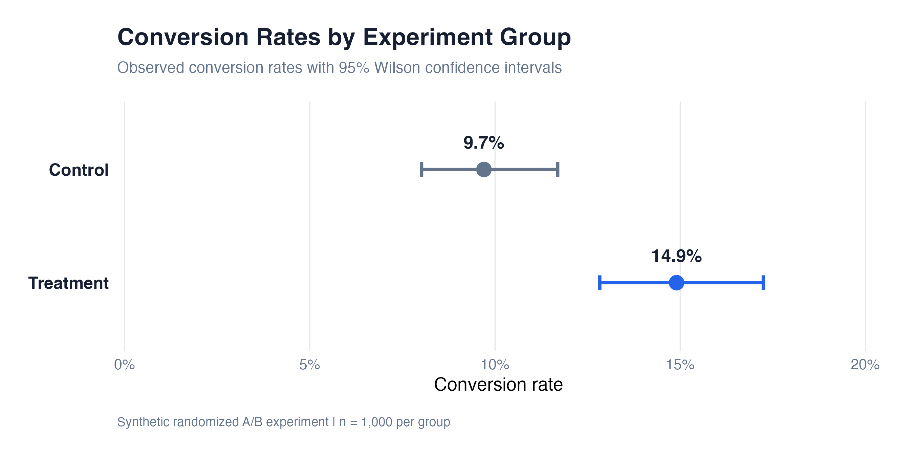
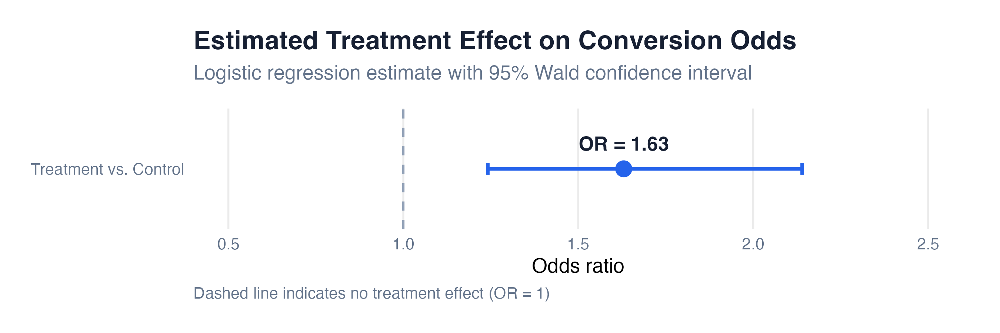

# Logistic Regression Validation in R

### Analytical Verification, Statistical Inference, and A/B Testing

An end-to-end statistical analysis project demonstrating logistic regression, independent maximum likelihood validation, hypothesis testing, and reproducible research using R.

This project evaluates conversion outcomes from a synthetic randomized A/B experiment and independently verifies statistical estimates against R's `glm()` implementation.

## Key Results

| Metric | Result |
|---|---:|
| Sample size | 2,000 |
| Control conversion rate | 9.7% |
| Treatment conversion rate | 14.9% |
| Absolute conversion uplift | +5.2 percentage points |
| 95% CI for absolute uplift | [2.33, 8.07] percentage points |
| Relative conversion uplift | +53.6% |
| Treatment odds ratio | 1.63 |
| 95% Wald confidence interval | [1.24, 2.14] |
| Wald test p-value | 0.000438 |
| Likelihood-ratio test p-value | 0.000382 |

Both hypothesis tests provide evidence of a positive treatment effect in the simulated experiment.

**Note:** All data are synthetic. Results illustrate statistical methodology rather than findings from a real business experiment.

## Conversion Rate Analysis



The treatment group achieved a higher observed conversion rate than the control group. Error bars represent 95% Wilson score confidence intervals for the individual group proportions.

## Logistic Regression Treatment Effect



The estimated treatment odds ratio is approximately 1.63, indicating 63% higher conversion odds for the treatment group. The 95% Wald confidence interval excludes the null value of 1.

## Statistical Methodology


The binary response is modeled using logistic regression:

$$
\log\left(\frac{p_i}{1-p_i}\right) = \beta_0 + \beta_1 x_i
$$

Here:

- $p_i$ is the probability of conversion.
- $x_i$ is the binary treatment indicator.
- $\beta_0$ is the control-group log-odds.
- $\beta_1$ is the treatment effect on log-odds.

The treatment odds ratio is $e^{\beta_1}$.


The project includes:

- **Maximum likelihood estimation:** Fit a binomial logistic regression model using `glm()`.
- **Independent coefficient validation:** Derive closed-form maximum likelihood estimates from the observed contingency table.
- **Standard error validation:** Independently calculate standard errors using the analytical variance formulas.
- **Wald inference:** Reproduce z-statistics, two-sided p-values, and confidence intervals.
- **Likelihood-ratio testing:** Compare the full model against an intercept-only model.
- **Numerical diagnostics:** Investigate convergence precision and verify agreement between analytical and numerical estimates.

## Reproducibility

The analysis uses a fixed random seed and organized R scripts to support reproducibility.

### Requirements

- R
- `ggplot2`
- `rmarkdown`
- `knitr`

### Run the Analysis

From the repository's root directory, execute:

```r
source("R/01_generate_data.R")
source("R/02_fit_model.R")
source("R/03_validate_model.R")
source("R/04_likelihood_ratio_test.R")
source("R/05_visualize_results.R")
source("R/06_odds_ratio_plot.R")
```

To regenerate the HTML report:

```r
rmarkdown::render("reports/statistical_analysis.Rmd")
```

The validation script contains automated checks comparing analytical estimates with numerical model output.

## Full Statistical Report

For the complete methodology, mathematical derivations,
validation tables, hypothesis tests, and limitations:

**[View Full Statistical Report](https://sal-tedder.github.io/logistic-regression-validation/)**

Additional resources:

- [R Markdown Source](reports/statistical_analysis.Rmd)
- [HTML Report Source File](reports/statistical_analysis.html)

## Limitations

The dataset is synthetic and the model contains only one binary predictor. The project emphasizes statistical estimation and inference rather than advanced predictive modeling.

The analysis assumes independent Bernoulli observations and relies on large-sample approximations for Wald and likelihood-ratio inference.

Future extensions could include additional predictors, treatment interactions, simulation-based coverage studies, and predictive performance evaluation.

## Technical Skills Demonstrated

**R Programming · Logistic Regression · Maximum Likelihood Estimation · Statistical Inference · A/B Testing · Model Validation · Numerical Diagnostics · Data Visualization · Reproducible Research**