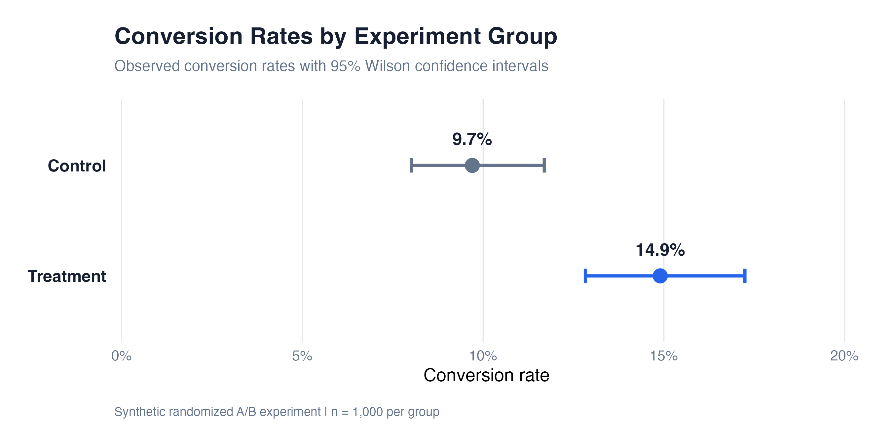
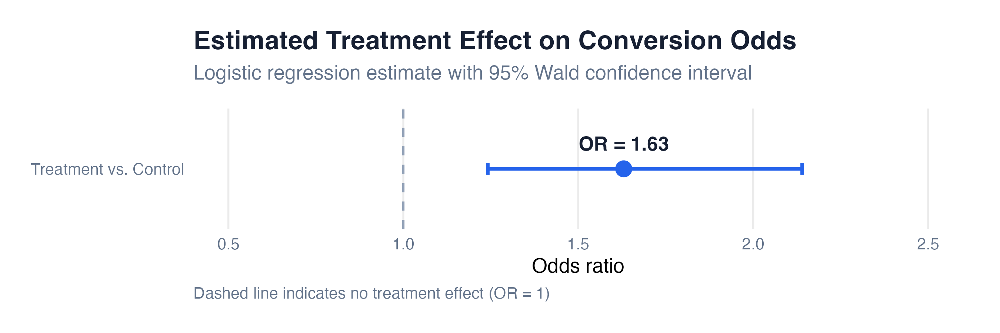

---
title: "Logistic Regression: Analytical Validation and Statistical Inference"
subtitle: "A Reproducible Analysis of a Synthetic A/B Experiment"
author: "Salvatore Tedder"
output:
  html_document:
    toc: true
    toc_depth: 3
    number_sections: true
    theme: readable
---

```{r setup, include=FALSE}
knitr::opts_chunk$set(
  echo = TRUE,
  warning = FALSE,
  message = FALSE
)

# Load data relative to the reports directory
data <- read.csv("../data/synthetic_conversions.csv")

# Fit logistic regression
model <- glm(
  converted ~ treatment,
  data = data,
  family = binomial(link = "logit"),
  control = glm.control(
    epsilon = 1e-12,
    maxit = 100
  )
)

stopifnot(isTRUE(model$converged))
```

# Executive Summary

This project evaluates the effect of a simulated website
redesign on customer conversion rates using binomial
logistic regression.

The dataset consists of 2,000 synthetic observations,
equally allocated between control and treatment groups.

The analysis examines observed conversion rates,
estimates the treatment effect, and independently
validates logistic regression calculations against
R's `glm()` implementation.

The primary objective is to demonstrate reproducible
statistical modeling, mathematical verification,
numerical diagnostics, and statistical inference.


# Experimental Design

## Research Question

Does a redesigned website increase the probability
that a visitor completes a purchase?

## Data Generation

A synthetic randomized A/B experiment was simulated
using Bernoulli-distributed conversion outcomes.

The experiment includes:

- 2,000 simulated visitors
- 1,000 observations per group
- Baseline conversion probability: 10%
- Treatment conversion probability: 15%
- Binary response: conversion (0 = no, 1 = yes)
- Binary predictor: treatment (0 = control, 1 = redesign)

The simulation uses a fixed random seed to ensure
reproducibility.

## Statistical Hypotheses

The null hypothesis states that the treatment has
no effect on conversion odds:

$$
H_0: \beta_1 = 0
$$

The alternative hypothesis is:

$$
H_A: \beta_1 \neq 0
$$

A two-sided significance level of 0.05 is used.


# Exploratory Data Analysis

```{r conversion-summary}
# Calculate observed conversion rates

conversion_summary <- aggregate(
  converted ~ treatment,
  data = data,
  FUN = mean
)

names(conversion_summary) <- c(
  "Treatment",
  "Conversion Rate"
)

conversion_summary$Group <- c(
  "Control",
  "Treatment"
)

conversion_summary <- conversion_summary[
  , c("Group", "Conversion Rate")
]

knitr::kable(
  conversion_summary,
  digits = 3,
  caption = "Observed Conversion Rates"
)
```

The observed conversion rates provide an initial
descriptive comparison between the two experimental
groups. Statistical inference is required to quantify
uncertainty in the estimated treatment effect.


## Conversion Rate Visualization

```{r conversion-figure, echo=FALSE, out.width="100%"}

```

The figure displays the observed conversion rates
and 95% Wilson score confidence intervals for
each group's conversion probability.


# Statistical Methodology

## Logistic Regression Model

The binary conversion outcome is modeled using
binomial logistic regression.

For visitor \(i\), let \(Y_i\) indicate conversion,
where \(Y_i = 1\) represents a purchase and
\(Y_i = 0\) represents no purchase.

We assume:

$$
Y_i \sim \operatorname{Bernoulli}(p_i)
$$

The logistic regression model is:

$$
\log\left(\frac{p_i}{1-p_i}\right)
=
\beta_0+\beta_1 x_i
$$

where:

- \(p_i\) is the probability of conversion.
- \(x_i\) is the treatment indicator.
- \(\beta_0\) is the control-group log-odds.
- \(\beta_1\) is the treatment effect on log-odds.

The treatment odds ratio is:

$$
OR = e^{\beta_1}
$$

## Maximum Likelihood Estimation

Model coefficients are estimated by maximizing
the Bernoulli log-likelihood:

$$
\ell(\boldsymbol{\beta})
=
\sum_{i=1}^{n}
\left[
y_i\log(p_i)
+
(1-y_i)\log(1-p_i)
\right]
$$

The probabilities are linked to the predictors by:

$$
p_i =
\frac{1}
{1+\exp[-(\beta_0+\beta_1 x_i)]}
$$

R's `glm()` function estimates the coefficients
using iteratively reweighted least squares (IRLS).


## Fitted Model Results

```{r model-results}
# Extract coefficient summary
model_results <- summary(model)$coefficients

knitr::kable(
  model_results,
  digits = 6,
  caption = "Logistic Regression Coefficient Estimates"
)
```

The treatment coefficient represents the difference
in log-odds of conversion between treatment and
control groups.

Exponentiating this coefficient produces the
estimated treatment odds ratio.


# Independent Analytical Validation

## Closed-Form Coefficient Estimates

Because the model contains a single binary predictor,
the maximum likelihood coefficients can be calculated
directly from the observed contingency table,
provided all four cell counts are positive.

Let:

- \(a\): Treatment conversions
- \(b\): Treatment non-conversions
- \(c\): Control conversions
- \(d\): Control non-conversions

The intercept estimate is:

$$
\hat{\beta}_0 =
\log\left(\frac{c}{d}\right)
$$

The treatment coefficient estimate is:

$$
\hat{\beta}_1 =
\log\left(\frac{a}{b}\right)
-
\log\left(\frac{c}{d}\right)
$$

```{r analytical-validation}
# Extract contingency-table counts
counts <- table(data$treatment, data$converted)

a <- as.numeric(counts["1", "1"])
b <- as.numeric(counts["1", "0"])
c <- as.numeric(counts["0", "1"])
d <- as.numeric(counts["0", "0"])

stopifnot(all(c(a, b, c, d) > 0))

# Calculate analytical coefficients
beta_0 <- log(c / d)
beta_1 <- log(a / b) - log(c / d)

analytical_coef <- c(
  "(Intercept)" = beta_0,
  "treatment" = beta_1
)

# Compare analytical and glm estimates
comparison <- data.frame(
  Term = names(analytical_coef),
  Analytical = unname(analytical_coef),
  GLM = unname(coef(model)),
  Absolute_Difference = abs(
    unname(analytical_coef) -
    unname(coef(model))
  )
)

knitr::kable(
  comparison,
  digits = 10,
  caption = "Analytical vs. Numerical Coefficient Estimates"
)

# Automated validation
stopifnot(
  isTRUE(all.equal(
    unname(analytical_coef),
    unname(coef(model)),
    tolerance = 1e-6
  ))
)
```

The analytical estimates are compared against
the numerical estimates returned by `glm()`.

Agreement within the specified tolerance provides
an independent verification of the fitted coefficients.


## Standard Error Validation

The asymptotic standard errors can be calculated
directly from the observed contingency-table counts.

For the intercept:

$$
SE(\hat{\beta}_0)
=
\sqrt{\frac{1}{c}+\frac{1}{d}}
$$

For the treatment coefficient:

$$
SE(\hat{\beta}_1)
=
\sqrt{
\frac{1}{a}+
\frac{1}{b}+
\frac{1}{c}+
\frac{1}{d}
}
$$

These expressions are derived from the inverse
Fisher information matrix for the fitted model.

```{r standard-error-validation}
# Calculate analytical standard errors
analytical_se <- c(
  "(Intercept)" = sqrt(1/c + 1/d),
  "treatment" = sqrt(1/a + 1/b + 1/c + 1/d)
)

# Extract numerical standard errors
glm_se <- summary(model)$coefficients[, "Std. Error"]

# Compare estimates
se_comparison <- data.frame(
  Term = names(analytical_se),
  Analytical_SE = unname(analytical_se),
  GLM_SE = unname(glm_se),
  Absolute_Difference = abs(
    unname(analytical_se) - unname(glm_se)
  )
)

knitr::kable(
  se_comparison,
  digits = 10,
  caption = "Analytical vs. GLM Standard Errors"
)

# Automated validation
stopifnot(
  isTRUE(all.equal(
    unname(analytical_se),
    unname(glm_se),
    tolerance = 1e-6
  ))
)
```

The agreement between analytical and numerical
standard errors supports the correctness of the
model's uncertainty estimates.


## Wald Hypothesis Tests

The Wald statistic evaluates whether an estimated
coefficient differs significantly from zero.

For each coefficient:

$$
z_j =
\frac{\hat{\beta}_j}
{SE(\hat{\beta}_j)}
$$

Under the null hypothesis and standard asymptotic
conditions, the statistic follows approximately
a standard normal distribution.

The two-sided p-value is:

$$
p_j = 2\Phi(-|z_j|)
$$

```{r wald-validation}
# Calculate Wald statistics independently
analytical_z <- analytical_coef / analytical_se

# Calculate two-sided p-values
analytical_p <- 2 * pnorm(-abs(analytical_z))

# Extract glm statistics
glm_summary <- summary(model)$coefficients

wald_comparison <- data.frame(
  Term = names(analytical_z),
  Analytical_Z = unname(analytical_z),
  GLM_Z = unname(glm_summary[, "z value"]),
  Analytical_P = unname(analytical_p),
  GLM_P = unname(glm_summary[, "Pr(>|z|)"])
)

knitr::kable(
  wald_comparison,
  digits = 8,
  caption = "Independent Wald Test Validation"
)

# Automated validation
stopifnot(
  isTRUE(all.equal(
    unname(analytical_z),
    unname(glm_summary[, "z value"]),
    tolerance = 1e-6
  )),
  isTRUE(all.equal(
    unname(analytical_p),
    unname(glm_summary[, "Pr(>|z|)"]),
    tolerance = 1e-6
  ))
)
```

The independently calculated Wald statistics
and p-values are compared with R's model output
to verify statistical inference.


## Treatment Odds Ratio and Confidence Interval

The treatment odds ratio is obtained by
exponentiating the estimated treatment coefficient:

$$
\widehat{OR} = e^{\hat{\beta}_1}
$$

A 95% Wald confidence interval is calculated as:

$$
\exp\left(
\hat{\beta}_1
\pm 1.96\,SE(\hat{\beta}_1)
\right)
$$

```{r odds-ratio-results}
# Calculate treatment odds ratio
odds_ratio <- exp(analytical_coef["treatment"])

# Calculate 95% Wald confidence interval
z_critical <- qnorm(0.975)

ci_lower <- exp(
  analytical_coef["treatment"] -
  z_critical * analytical_se["treatment"]
)

ci_upper <- exp(
  analytical_coef["treatment"] +
  z_critical * analytical_se["treatment"]
)

or_results <- data.frame(
  Odds_Ratio = unname(odds_ratio),
  CI_Lower = unname(ci_lower),
  CI_Upper = unname(ci_upper)
)

knitr::kable(
  or_results,
  digits = 4,
  caption = "Treatment Odds Ratio and 95% Wald CI"
)
```

An odds ratio greater than one indicates higher
conversion odds in the treatment group.

Because the confidence interval excludes one,
the estimated treatment effect is statistically
significant at the 5% level.


# Likelihood-Ratio Test

## Model Comparison

The likelihood-ratio test evaluates whether including
the treatment indicator significantly improves model
fit compared with an intercept-only model.

The competing models are:

**Null model:**

$$
\log\left(\frac{p_i}{1-p_i}\right)=\beta_0
$$

**Full model:**

$$
\log\left(\frac{p_i}{1-p_i}\right)
=\beta_0+\beta_1x_i
$$

The likelihood-ratio statistic is:

$$
G^2=2\left[
\ell(\hat{\beta}_{full})
-
\ell(\hat{\beta}_{null})
\right]
$$

Under the null hypothesis and standard regularity
conditions, this statistic follows approximately
a chi-square distribution with one degree of freedom.

```{r likelihood-ratio-test}
# Fit intercept-only model
null_model <- glm(
  converted ~ 1,
  data = data,
  family = binomial(link = "logit"),
  control = glm.control(
    epsilon = 1e-12,
    maxit = 100
  )
)

stopifnot(isTRUE(null_model$converged))

# Extract maximized log-likelihoods
ll_full <- as.numeric(logLik(model))
ll_null <- as.numeric(logLik(null_model))

# Calculate likelihood-ratio statistic
lr_stat <- 2 * (ll_full - ll_null)

# Degrees of freedom
lr_df <- attr(logLik(model), "df") -
  attr(logLik(null_model), "df")

# Calculate p-value
lr_p <- pchisq(
  lr_stat,
  df = lr_df,
  lower.tail = FALSE
)

# Compare with R's built-in deviance test
anova_results <- anova(
  null_model,
  model,
  test = "Chisq"
)

# Validate independent calculation
stopifnot(
  isTRUE(all.equal(
    unname(lr_stat),
    unname(anova_results$Deviance[2]),
    tolerance = 1e-6
  )),
  isTRUE(all.equal(
    unname(lr_p),
    unname(anova_results$`Pr(>Chi)`[2]),
    tolerance = 1e-6
  ))
)

# Display results
lr_results <- data.frame(
  Statistic = lr_stat,
  Degrees_of_Freedom = lr_df,
  P_Value = lr_p
)

knitr::kable(
  lr_results,
  digits = 6,
  caption = "Likelihood-Ratio Test Results"
)
```

## Interpretation

The likelihood-ratio test evaluates whether the
treatment indicator contributes statistically
significant explanatory information.

A small p-value provides evidence against the
null hypothesis of equal conversion odds.

The likelihood-ratio and Wald tests examine the
same null hypothesis but use different asymptotic
test statistics. Their p-values need not be identical.


## Comparison of Statistical Tests

```{r test-comparison}
# Wald test for treatment coefficient
wald_z <- unname(analytical_z["treatment"])
wald_p <- unname(analytical_p["treatment"])

test_comparison <- data.frame(
  Test = c(
    "Wald",
    "Likelihood Ratio"
  ),
  Statistic = c(
    wald_z,
    lr_stat
  ),
  P_Value = c(
    wald_p,
    lr_p
  )
)

knitr::kable(
  test_comparison,
  digits = 6,
  caption = "Comparison of Statistical Tests"
)
```

Both tests evaluate the null hypothesis that the
treatment coefficient equals zero.

The Wald test standardizes the estimated coefficient
using its standard error, while the likelihood-ratio
test compares maximized log-likelihoods.

Although the resulting p-values differ slightly,
both tests support rejecting the null hypothesis
at the 5% significance level.


# Treatment Effect Visualization

```{r odds-ratio-figure, echo=FALSE, out.width="100%"}

```

The point represents the estimated treatment odds
ratio, while the horizontal interval represents
its 95% Wald confidence interval.

The dashed vertical line at an odds ratio of one
represents the null hypothesis of no treatment effect.

Because the confidence interval lies entirely above
one, the results support a positive treatment effect
in the simulated experiment.


# Limitations and Future Extensions

## Limitations

Although the analysis demonstrates statistically significant
differences in conversion rates, several limitations should
be considered.

### Synthetic Data

The dataset was generated through simulation rather than
collected from an actual business experiment.

Consequently, the estimated treatment effect demonstrates
statistical methodology and does not constitute empirical
evidence that a real website redesign improves conversions.

### Simplified Model Specification

The logistic regression model contains only one binary
predictor: treatment assignment.

This specification is appropriate for estimating the
unadjusted treatment effect in a randomized experiment,
but it does not account for additional visitor characteristics
or potential treatment-effect heterogeneity.

### Independence Assumption

The simulation assumes independent Bernoulli outcomes
across observations.

In real applications, repeated visits, customer clustering,
or temporal dependence could violate this assumption and
require alternative variance estimation or model structures.

### Statistical vs. Practical Significance

Statistical significance does not necessarily imply
business value.

A real deployment decision would also require consideration
of implementation costs, revenue per conversion,
customer experience, and uncertainty in the absolute
conversion-rate improvement.

### Numerical and Inferential Considerations

The Wald and likelihood-ratio tests rely on large-sample
approximations.

Although the sample size and observed cell counts are
adequate for these methods, sparse data or complete
separation could produce unreliable estimates or
invalidate standard approximations.

## Future Extensions

Potential extensions include:

- Incorporating additional visitor-level predictors.
- Evaluating treatment interactions and heterogeneous effects.
- Comparing Wald, score, and likelihood-ratio tests.
- Investigating performance under smaller sample sizes.
- Conducting simulation studies of confidence interval coverage.
- Examining predictive calibration and discrimination when
  additional informative predictors are available.


# Conclusion

This project developed and independently validated a
binomial logistic regression model using a reproducible
synthetic randomized A/B experiment.

The observed conversion rate increased from 9.7% in the
control group to 14.9% in the treatment group, representing
an absolute increase of 5.2 percentage points.

The fitted logistic regression model estimated a treatment
odds ratio of approximately 1.63, with a 95% Wald confidence
interval of approximately 1.24 to 2.14.

Both Wald and likelihood-ratio tests provided evidence
against the null hypothesis of equal conversion odds.

A central contribution of the project was the independent
analytical verification of model coefficients, standard
errors, Wald statistics, and p-values against R's `glm()`
implementation.

The analysis also investigated numerical convergence
precision, demonstrating the importance of validating
computational results rather than accepting statistical
software output without examination.

Overall, the project illustrates a reproducible workflow
for statistical modeling, numerical validation, inference,
and communication of results.

